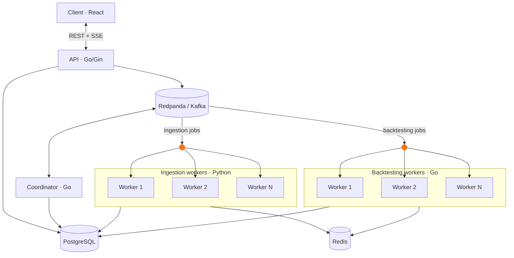

# Backtesting Engine

A distributed algorithmic-trading backtesting platform. Pick a universe of symbols (NASDAQ 100, S&P 500 or a custom list), a date range and one or more strategies; the system ingests the historical data, runs every symbol/strategy pair in parallel and aggregates the results into a live dashboard with equity curves, metrics and per-stage timings.


## Features

- **Strategies:** Buy and Hold, SMA Cross, MACD, RSI Mean Reversion, Bollinger Bands.
- **Parallel by design:** each symbol/strategy pair is an independent job, so adding workers adds throughput.
- **Live progress:** staged experiment lifecycle (ingestion, backtesting, aggregation) streamed to the browser over Server-Sent Events, with per-stage durations.
- **Results:** total/annualized return, Sharpe, max drawdown, win rate, trade count, per-symbol table and multi-strategy equity curves.
- **Resilient:** worker heartbeats, atomic cancellation, ingestion de-duplication and market-data caching.
- **Built-in auth** (JWT), rate limiting at the edge, mobile-responsive UI.

## Architecture



| Component | Role |
|---|---|
| **Client** | React UI to create experiments, watch live progress and inspect results. Talks only to the API. |
| **API** | JWT auth, experiment CRUD, publishes jobs, serves status, results and the SSE event stream. |
| **Coordinator** | Owns the experiment lifecycle: fans an experiment out into jobs, advances stages, monitors worker heartbeats, handles cancellation, aggregates metrics and curves. |
| **Ingestion workers** | Download and normalize historical market data into PostgreSQL (cached via Redis). |
| **Backtesting workers** | Run a strategy over one symbol through a simulated broker/portfolio and report metrics and the equity curve. |
| **Redpanda** | Kafka-compatible event bus and job queue between services. |
| **PostgreSQL / Redis** | Source of truth (users, experiments, jobs, market data, results) / market-data cache. |

**Experiment lifecycle:** `PENDING` → `CREATING_INGESTION_JOBS` → `PENDING_INGESTION` → `CREATING_BACKTEST_JOBS` → `RUNNING` → `AGGREGATING` → `COMPLETED` (or `FAILED` / `CANCELLED`).

The homepage also shows an interactive version of this diagram and a sample results dashboard.

## Tech stack

- **Backend:** Go (Gin, gRPC, pgx), Python (ingestion), Redpanda, PostgreSQL, Redis
- **Frontend:** React 19, Vite, TypeScript, Tailwind CSS + shadcn/ui, TanStack Query/Router, Zustand, React Hook Form + Zod, Recharts
- **Infra:** Docker Compose (`dev`, `prod`, `test` profiles), GitHub Actions, GHCR, Caddy

## Repository layout

```
cmd/            service entrypoints (api, coordinator, worker, migrate)
core/           Go packages: api, coordinator, worker, strategy, broker, portfolio, simulator, data, kafka, db
ingestion/      Python ingestion worker
client/         React frontend (nginx in prod)
deploy/caddy/   HTTPS reverse-proxy templates
```

## Quick start

```bash
cp .env.example .env        # edit values; comments in the file explain each one
docker compose --profile dev up --build
```

- UI: <http://localhost:5173> · API: <http://localhost:8080>
- All services live-reload in `dev`.
- Scale workers: `docker compose --profile dev up -d --scale worker-dev=5 --scale ingestion-dev=3`

### Tests

```bash
docker compose --profile test run --rm test          # Go backend tests (with DB + migrations)
docker compose --profile test run --rm client-test   # client lint + typecheck + build
```

### Database

```bash
migrate create -ext sql -dir core/db/migrations -seq name   # new migration
docker compose down -v                                       # wipe all data
```

## Production

```bash
docker compose --profile prod up -d --build
```

Runs the optimized, non-root stack with healthchecks, restart policies and ordered startup (Postgres → migrations → Kafka topics → services). The client's nginx serves the UI and proxies `/api/` (including SSE) to the API, so there is no CORS or hard-coded API URL. For a separate API origin, build the client with `VITE_API_URL` and set `CORS_ALLOWED_ORIGINS`.

> Building every image at once needs a few GB of RAM. On small machines use `COMPOSE_PARALLEL_LIMIT=1 docker compose --profile prod build`.

**Checklist**

- `JWT_SECRET`: random, 32+ chars (`openssl rand -hex 32`); the API refuses to start in release mode otherwise.
- Strong `POSTGRES_PASSWORD` and matching `DATABASE_URL` (percent-encode special characters).
- Postgres, Redis, Kafka and the coordinator bind to `127.0.0.1` (`BIND_ADDRESS`); expose only the client (80) and API (8080).
- Terminate TLS in front (see below) and back up the `postgres_data` volume.
- Single-node Redpanda/Postgres/Redis run in containers; for HA point `DATABASE_URL`, `REDIS_URL` and `KAFKA_BROKERS` at managed services.

**Rate limiting** (client nginx, per IP): login/register 5/min (burst 5), other `/api/` 10/s (burst 30), max 30 open connections. Over-limit requests get `429`. Behind a proxy, set nginx `set_real_ip_from` / `real_ip_header` so visitors aren't pooled.

### HTTPS with Caddy

A shared Caddy (outside this compose file, templates in `deploy/caddy/`) terminates TLS with automatic Let's Encrypt certificates.

1. Point a DNS `A` record at the server and open ports 80/443.
2. In the server `.env`: `CLIENT_PROD_BIND=127.0.0.1`, `CLIENT_PROD_HOST_PORT=8081`, `API_BIND=127.0.0.1`.
3. Add to the Caddyfile and reload (`docker exec caddy caddy reload --config /etc/caddy/Caddyfile`):
   ```
   backtesting.example.com {
       encode gzip
       reverse_proxy 127.0.0.1:8081
   }
   ```

## CI/CD

| Workflow | Trigger | Does |
|---|---|---|
| `ci.yml` | PRs, pushes to `main` | Backend tests, client lint/typecheck/build, builds prod images, boots the stack and smoke-tests it |
| `deploy.yml` | `ci.yml` passes on `main` (or manual) | Pushes images to GHCR (`ghcr.io/<owner>/backtesting-<service>`), deploys over SSH |

**Setup:** allow read/write workflow permissions; on the server create `/opt/backtesting/.env` (Docker + Compose plugin, a deploy user in the `docker` group); add repo secrets `DEPLOY_HOST` (unset = publish images only), `DEPLOY_USER`, `DEPLOY_PATH`, `DEPLOY_SSH_KEY`, `DEPLOY_KNOWN_HOSTS` (`ssh-keyscan <host>`). To also deploy to a second server (the workflow targets `azure` and `oracle`), add the same set prefixed `DEPLOY_ORACLE_` (`DEPLOY_ORACLE_HOST`, `_USER`, `_PATH`, `_SSH_KEY`, `_KNOWN_HOSTS`). Images are built for amd64 and arm64. Optionally add a `production` Environment with required reviewers.

Each deploy copies `docker-compose.yml` and migrations, pulls SHA-tagged images, runs migrations and restarts changed services. Roll back by re-running the workflow on an older commit, or on the server:

```bash
IMAGE_REGISTRY=ghcr.io/<owner>/ IMAGE_TAG=<old-sha> docker compose --profile prod up -d --no-build
```
