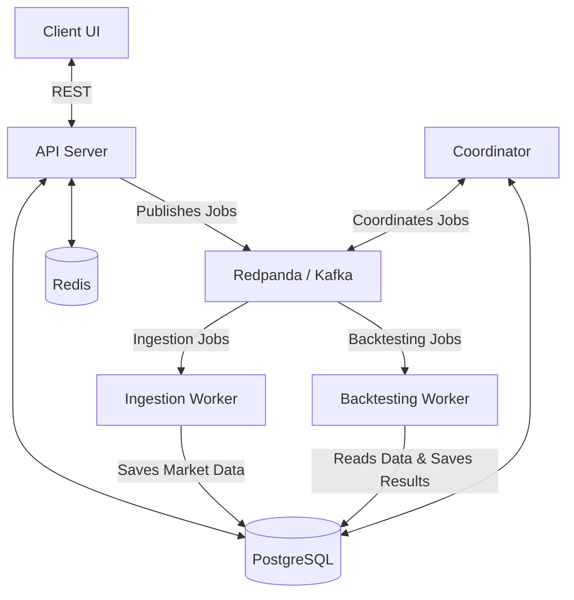

# Backtesting Engine


A scalable, distributed algorithmic trading backtesting platform.

This platform allows users to define custom algorithmic trading strategies, simulate their performance against historical market data, and evaluate their efficacy. It leverages a microservices architecture to ensure high throughput and scalability, especially when backtesting across numerous assets (like the NASDAQ 100 or S&P 500) over long timeframes.

## Architecture & How It Works

The backtesting engine is composed of several specialized services communicating through a Kafka-compatible message broker (Redpanda) and backed by PostgreSQL and Redis.



### Core Components

- **Client**: The frontend interface for creating and monitoring experiments.
- **API**: The main entry point for the frontend, handling user requests and experiment creation.
- **Coordinator**: Manages the lifecycle of jobs, orchestrating distributed tasks across workers.
- **Ingestion Worker**: Responsible for fetching historical market data from external providers and storing it in the database.
- **Backtesting Worker**: Executes the actual trading algorithms against the ingested historical data.
- **Redpanda (Kafka)**: The message broker facilitating asynchronous communication between services.
- **PostgreSQL**: The primary relational database for storing experiments, market data, and results.
- **Redis**: Caching layer for high-performance data retrieval.

## Running the Application

The project uses Docker Compose with profiles to manage different environments seamlessly.

### Development Environment

The `dev` profile runs the application with live-reloading enabled for all services (API, Workers, Coordinator, and Client).

1. **Start all services:**
   ```bash
   docker compose --profile dev up --build
   ```
2. **Access the Application:**
   - Client UI: `http://localhost:5173`
   - API Server: `http://localhost:8080`

3. **Scaling Workers (Optional):**
   You can scale the ingestion and backtesting workers to speed up processing:
   ```bash
   docker compose --profile dev up -d --scale worker-dev=5 --scale ingestion-dev=3
   ```

### Production Environment

The `prod` profile builds optimized images and runs the application without development tools (like live-reloading).

1. **Start all services:**
   ```bash
   docker compose --profile prod up -d --build
   ```
2. **Access the Application:**
   - Client UI: `http://localhost` (Port 80)
   - API Server: `http://localhost:8080`

### Testing

You can run automated tests for both the backend and frontend using Docker Compose.

**Run Backend Tests**
Spins up the database, applies migrations, and executes all Go backend tests:
```bash
docker compose --profile test run --rm test
```

**Run Client Tests**
Runs linting and builds the frontend client to verify correctness:
```bash
docker compose --profile test run --rm client-test
```

## Database Management

**Generate a New Database Migration**
```bash
migrate create -ext sql -dir core/db/migrations -seq your_migration_name
```

**Reset the Database Completely (Wipes Data)**
```bash
docker compose down -v
```
