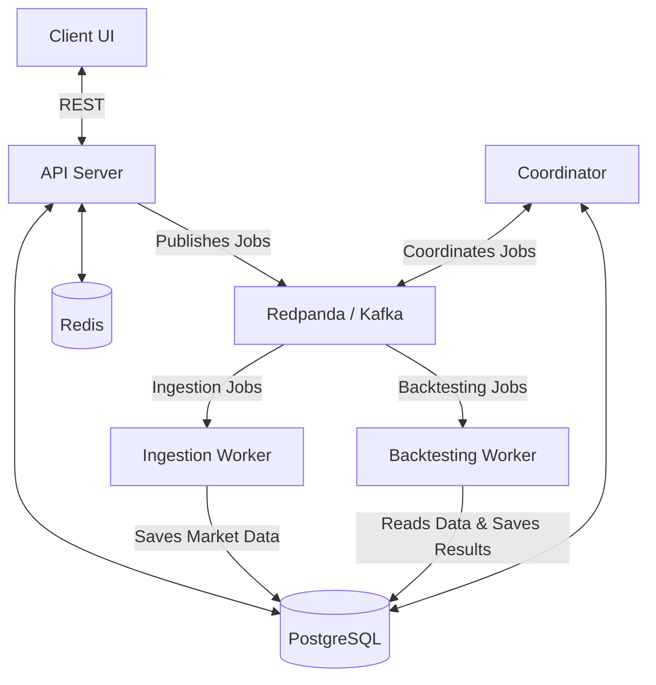

# Backtesting Engine


A scalable, distributed algorithmic trading backtesting platform.

This platform allows users to define custom algorithmic trading strategies, simulate their performance against historical market data, and evaluate their efficacy. It leverages a microservices architecture to ensure high throughput and scalability, especially when backtesting across numerous assets (like the NASDAQ 100 or S&P 500) over long timeframes.

## Tech Stack

**Backend & Frameworks**
- **Go**: Core backend services (API, Coordinator, Workers)
- **Gin**: HTTP web framework for the API
- **gRPC**: Inter-service communication
- **Redpanda (Kafka)**: Distributed event streaming and job queue
- **PostgreSQL (pgx)**: Primary relational database driver
- **Redis**: High-performance caching layer
- **Docker & Docker Compose**: Containerization and orchestration

**Frontend & Frameworks**
- **React 19**: UI library
- **Vite**: Build tool and development server
- **TypeScript**: Static typing
- **Tailwind CSS & shadcn/ui**: Styling and UI components
- **Zustand**: State management
- **TanStack Query (React Query)**: Data fetching and caching
- **TanStack Router**: Routing
- **React Hook Form & Zod**: Form handling and schema validation
- **Recharts**: Data visualization

## Architecture & How It Works

The backtesting engine is composed of several specialized services communicating through a Kafka-compatible message broker (Redpanda) and backed by PostgreSQL and Redis.



### Core Components

- **Client**: The frontend interface for creating and monitoring experiments.
- **API**: The main entry point for the frontend, handling user requests and experiment creation.
- **Coordinator**: Manages the lifecycle of jobs, orchestrating distributed tasks across workers.
- **Ingestion Worker**: Responsible for fetching historical market data from external providers and storing it in the database.
- **Backtesting Worker**: Executes the actual trading algorithms against the ingested historical data.
- **Redpanda (Kafka)**: The message broker facilitating asynchronous communication between services.
- **PostgreSQL**: The primary relational database for storing experiments, market data, and results.
- **Redis**: Caching layer for high-performance data retrieval.

## Running the Application

The project uses Docker Compose with profiles to manage different environments seamlessly.

### First-time setup

```bash
cp .env.example .env   # then edit; see the comments in the file
```

### Development Environment

The `dev` profile runs the application with live-reloading enabled for all services (API, Workers, Coordinator, and Client).

1. **Start all services:**
   ```bash
   docker compose --profile dev up --build
   ```
2. **Access the Application:**
   - Client UI: `http://localhost:5173`
   - API Server: `http://localhost:8080`

3. **Scaling Workers (Optional):**
   You can scale the ingestion and backtesting workers to speed up processing:
   ```bash
   docker compose --profile dev up -d --scale worker-dev=5 --scale ingestion-dev=3
   ```

### Production Environment

The `prod` profile builds optimized, non-root images and runs the full stack
(nginx client, API, coordinator, workers, ingestion, Postgres, Redis, Redpanda)
with restart policies, healthchecks and correct startup ordering
(Postgres -> migrations -> Kafka topics -> services).

1. **Configure** `.env` (see [Deployment checklist](#deployment-checklist)).
2. **Start all services:**
   ```bash
   docker compose --profile prod up -d --build
   ```
3. **Access the Application:**
   - Client UI: `http://localhost` (port `CLIENT_PROD_HOST_PORT`, default 80)
   - API: `http://localhost:8080`, also reachable same-origin at `/api/` through the client

The browser only talks to the client's nginx; it proxies `/api/` (including the
SSE event stream) to the API, so there is no hardcoded API URL and no CORS to
configure. To host the API on a different origin, build the client with
`VITE_API_URL` and set `CORS_ALLOWED_ORIGINS` on the API.

> Building all images at once needs a few GB of RAM. On a small machine (or
> Docker Desktop's default 3 GB VM) build one at a time:
> `COMPOSE_PARALLEL_LIMIT=1 docker compose --profile prod build`

### Deployment checklist

- `JWT_SECRET`: random, 32+ chars (`openssl rand -hex 32`). The API refuses to start in release mode otherwise.
- `POSTGRES_PASSWORD` and the matching `DATABASE_URL`: strong password (percent-encode special characters in the URL).
- Postgres, Redis, Kafka and the coordinator only bind to `127.0.0.1` (`BIND_ADDRESS`). Leave it that way; only the client (80) and API (8080) are meant to be public.
- Put a TLS-terminating reverse proxy / load balancer (Caddy, Traefik, cloud LB) in front of the client port, or put TLS on nginx.
- Back up the `postgres_data` volume. `docker compose down -v` deletes it.
- Single-node Redpanda, Postgres and Redis run in containers here; for HA use managed services and point `DATABASE_URL`, `REDIS_URL` and `KAFKA_BROKERS` at them.

## CI/CD

Two GitHub Actions workflows live in `.github/workflows/`:

| Workflow | Trigger | What it does |
|---|---|---|
| `ci.yml` | PRs and pushes to `main` | Backend tests, client lint/typecheck/build, then builds the prod images, boots the full prod stack and smoke-tests it |
| `deploy.yml` | `ci.yml` succeeds on `main` (or manual run) | Builds and pushes the 5 prod images to GHCR, then deploys over SSH |

### One-time setup

1. **Push to GitHub.** CI works with no configuration (it uses `.env.example`).
2. **Registry:** nothing to configure; images are pushed to `ghcr.io/<owner>/backtesting-<service>` using the built-in `GITHUB_TOKEN`. In *Settings > Actions > General > Workflow permissions* allow read/write.
3. **Server** (any Linux host with Docker + Compose plugin):
   ```bash
   mkdir -p /opt/backtesting && cd /opt/backtesting
   # create .env here from .env.example with production values
   ```
   Create a dedicated deploy user in the `docker` group and an SSH key pair for it.
4. **GitHub repo secrets** (*Settings > Secrets and variables > Actions*):

   | Secret | Value |
   |---|---|
   | `DEPLOY_HOST` | server hostname/IP (leave unset to only publish images) |
   | `DEPLOY_USER` | deploy user |
   | `DEPLOY_PATH` | e.g. `/opt/backtesting` (holds `.env`) |
   | `DEPLOY_SSH_KEY` | private key |
   | `DEPLOY_KNOWN_HOSTS` | output of `ssh-keyscan <host>` |

5. **Optional approval gate:** create a GitHub *Environment* named `production` with required reviewers; the deploy job waits for approval.
6. Protect `main` and require the `CI Pipeline` checks before merging.

On each deploy the server receives `docker-compose.yml` + `core/db/migrations`, pulls the images tagged with the commit SHA, runs migrations, and restarts changed services. Roll back by re-running the workflow on an older commit, or on the server:

```bash
IMAGE_REGISTRY=ghcr.io/<owner>/ IMAGE_TAG=<old-sha> docker compose --profile prod up -d --no-build
```

### Testing

You can run automated tests for both the backend and frontend using Docker Compose.

**Run Backend Tests**
Spins up the database, applies migrations, and executes all Go backend tests:
```bash
docker compose --profile test run --rm test
```

**Run Client Tests**
Runs linting and builds the frontend client to verify correctness:
```bash
docker compose --profile test run --rm client-test
```

## Database Management

**Generate a New Database Migration**
```bash
migrate create -ext sql -dir core/db/migrations -seq your_migration_name
```

**Reset the Database Completely (Wipes Data)**
```bash
docker compose down -v
```
